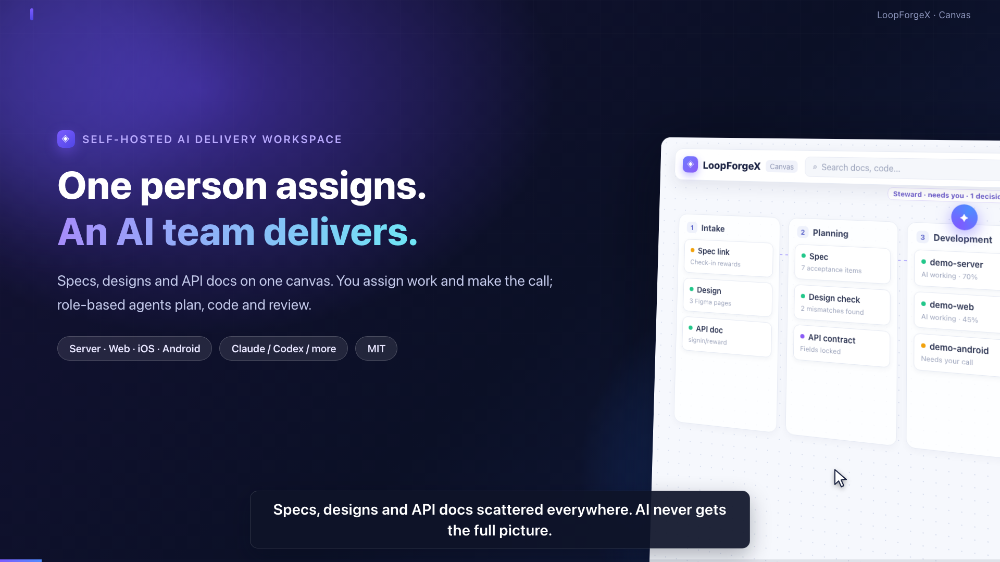
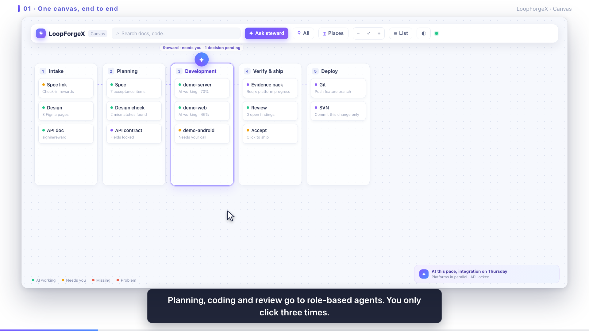
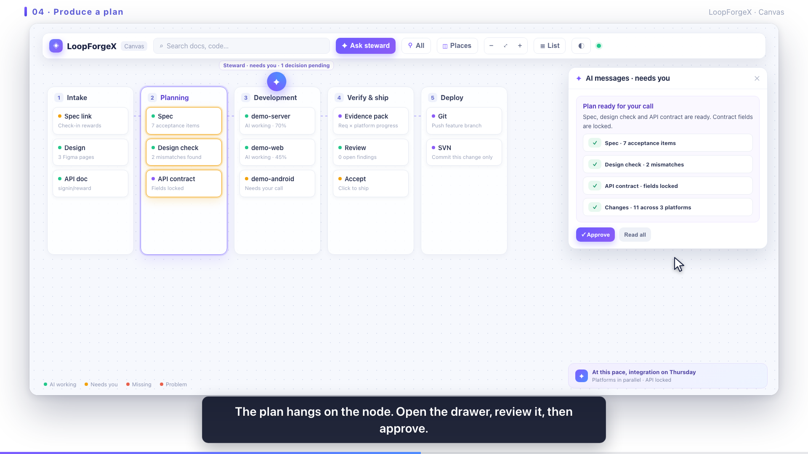
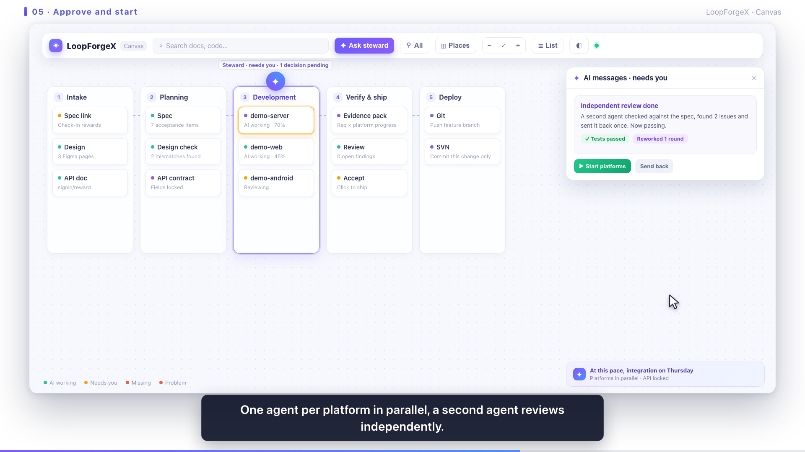
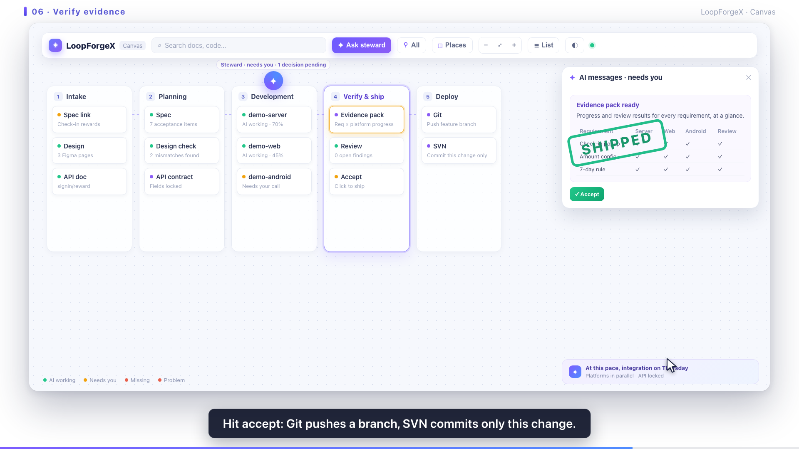

<p align="center">
  <picture>
    
  </picture>
</p>

<p align="center">
  <a href="assets/LoopForgeX-Product-Demo-EN.mp4"><b>▶ Watch the 96-second product tour (English, narrated)</b></a>
  · <a href="assets/demo-en.srt">Subtitles</a>
</p>

<p align="center">
  <a href="https://github.com/VcStrong/LoopForgeX/actions"></a>
  <a href="LICENSE"></a>
  
  <a href="https://github.com/VcStrong/LoopForgeX/stargazers"></a>
</p>

<p align="center">
  <b>English</b> · <a href="README.zh-CN.md">简体中文</a>
</p>

<p align="center">
  <a href="#two-ways-to-work">Two ways to work</a> · <a href="#why-loopforgex">Why LoopForgeX</a> · <a href="#quick-start">Quick start</a> · <a href="#how-a-flow-works">How a flow works</a> · <a href="#features">Features</a> · <a href="#faq">FAQ</a> · <a href="#documentation">Docs</a>
</p>

**LoopForgeX** (Local Knowledge Base · AI R&D workspace) is a self-hosted software delivery workspace. Bring specs, designs and API docs onto one project canvas; hand work to the **Steward** in chat. It opens a sandbox, delegates to project roles, runs checks, pauses at human gates for your call, and ships the code.

When a way of working proves itself, save it as a reusable **flow**: the next requirement is delivered the same way, with review and approval built in. Coding agents do the work; LoopForgeX adds the roles, sandboxes, gates, evidence and history around them — all on your own machine.

<p align="center">
  
  <sub>The canvas: a zoomable project map. Click any node to see details in the right-hand drawer.</sub>
</p>

## Two ways to work

Both paths track the same requirements. Use them separately or mix them.

| | Chat with the Steward | Run a flow |
|---|---|---|
| **Best for** | Exploring, quick fixes, iterating with the agent | Repeatable delivery with fixed stages and sign-off |
| **How it runs** | The Steward opens a conversation workspace (a sandbox with your repos) on demand and calls project roles as subagents | The engine runs Agent, Script, Human-gate and sub-flow nodes in order, each in its own sandbox |
| **You stay in control by** | Steering messages mid-reply, pausing, resuming or taking over a running flow | Approving at human gates, sending work back to a chosen step, retrying or rerunning from any node |
| **Delivers** | Changed code + conversation record | Code + per-node artifact snapshots + approval record |

Both paths share the same **requirement tracking**: every change, whether made in chat or by a flow, links back to what was asked for and counts toward delivery and cost reports.

## Why LoopForgeX

Ask a coding agent to "fix this bug" and the result depends on that run. It might skip the plan, forget the tests, review its own code, or stop halfway without anyone noticing.

That's fine for a demo, but it isn't how a team ships.

- **Repeatable.** Same flow, same stages, same checks for every requirement.
- **Separated roles.** Planning, implementation, review and testing each get their own prompt, executor, model and rules; review never uses the same role as development.
- **Human on the loop.** Agents run on their own; you only approve, start and accept at the key nodes — the AI cannot click those three for you.
- **Observable and resumable.** Node status, tool traces, logs and artifacts in one place; resume from a checkpoint after an interruption.
- **Your stack, your servers.** Code, materials and keys never leave your Mac or server. MIT licensed.

## Quick start

```sh
git clone https://github.com/VcStrong/LoopForgeX.git ~/loopforgex
cd ~/loopforgex && ./install.sh
# Deploy on a server: ./install.sh --host 0.0.0.0 --autostart
```

The browser opens after install. Three steps on the home page walk you through: **detect an AI engine → pick a local repo → add your first request**. Want something ready-made? Click "See a sample"; need help? Ask the Steward at the bottom right.

**What you need**

| I want to… | You need |
|---|---|
| Try the built-in script + human-gate demo | Git, Python 3, Docker (the installer guides you through setup) |
| Chat with the Steward, generate docs or a new project | The above + a signed-in coding agent CLI |
| Change a real repository and open a PR | The above + repo access (per-host SSH key) and model credentials |

<details>
<summary><b>More setup details</b>: executors, credentials, sandboxes, access model</summary>

- **Executors**: multiple coding agent CLIs are supported; pick any. Each role has its own prompt, model and rules. Keys stay on your own machine.
- **Sandboxes**: runs are isolated in Docker; this requires access to the host Docker socket. This is a self-hosted setup for trusted teams, not a tenant-isolation boundary for public multi-tenant use.
- **Access model**: a fresh install listens on all interfaces and enables sign-up by default. Before exposing it, disable sign-up, configure HTTPS and restrict network reachability.
- **Git & SVN**: both are supported; the repo updates automatically before development, push and branch switches, and stops on conflicts.

</details>

## How a flow works

A **flow** is the path a delivery follows. Agents, scripts and people take part in the same run:

| Node | What it does |
|---|---|
| **Agent** | A project role (prompt + executor + model + rules + tools) that designs, implements, reviews or tests. |
| **Script** | A deterministic shell step: build, test, lint, generate a report. No AI where AI is not needed. |
| **Human gate** | Pauses the run until someone checks the artifacts and approves, or sends the work back to a step. |
| **Sub-flow** | Runs another flow as a sub-workflow. |

Each node declares its artifacts and dependencies; the engine starts each step once its dependencies complete.

<p align="center">
  
  <sub>Planning: spec, design check, platform changes and API contract hang on the node. Open the drawer, review, then approve.</sub>
</p>

<p align="center">
  
  <sub>After approval: one agent per platform works in parallel, a second agent reviews independently, and issues are sent back automatically (up to two rounds).</sub>
</p>

Halfway through and another platform needs a change? The development agent proposes it → an incremental plan is produced → you approve → the affected platforms catch up automatically. Flows can loop; you never start over.

<p align="center">
  
  <sub>Evidence pack: progress and review results for every requirement at a glance; code is pushed only after you accept.</sub>
</p>

## Features

| Area | What you get |
|---|---|
| **Canvas workspace** | A zoomable project map; five lanes carry intake → planning → development → verification → shipping. Click a node for the drawer. |
| **Two ways to work** | Chat with the Steward or run a flow; both share requirement tracking. |
| **Roles** | Reusable role definitions: prompt, executor, model, rules, Skills, MCP tools, artifacts and gates. |
| **Requirement → delivery** | End-to-end tracking, PR/MR status and merge detection; Git and SVN both supported. |
| **Runs & approvals** | Live node status, tool traces, per-node artifact snapshots; approve, send back, or rerun from any node. |
| **Bugs & crashes** | Read-only multi-platform sync, automatic grouping; mapping-based stack rebuild and recurrence alerts. |
| **Design check** | Each design page is compared with the spec during planning; mismatches are flagged first. |
| **Work stats** | Progress, issues solved and agent runs, summed up automatically. |
| **Plugins** | Connect external systems as plugins; the core stays generic. |
| **Team-ready** | Data stays on your server; the key decisions can only be made by a human. |

## Security

- 🔒 **Data stays with you**: installed on your Mac or server; materials never pass through third-party platforms.
- 👁️ **Bug platforms are read-only**: data is pulled, never written back; fix status is kept locally.
- 🗝️ **No plaintext secrets**: Mac keychain, encrypted file on servers; the web app requires login, remote connections use tokens.
- ✋ **Key decisions are yours**: approve, start and accept can only be clicked by you in the web app — the AI cannot do it for you.

> Note: the default install is meant for **trusted internal teams**. Docker sandboxes run through the host Docker socket, which is effectively host daemon access. Don't expose it to a public multi-tenant environment. Before going live, disable sign-up, configure HTTPS and restrict network reachability.

## FAQ

**Do I need a model API key to try it?**
No — the built-in script + human-gate demo runs without one, right after install. To have agents do real work, configure one coding agent CLI's credentials.

**Do I need GitHub?**
Not for the demo or for generating docs. Yes if you want to change a real repo and open a PR; other Git services and SVN are supported too.

**Should I chat or run a flow?**
Chat for exploration and one-off fixes. Turn a process into a flow when you'll repeat it many times and want the same checks and sign-off each time.

**How is this different from Dify, n8n or Flowise?**
Those are general-purpose automation / AI workflow builders. LoopForgeX is built for **software delivery with coding agents**: implementer and reviewer roles, sandboxes with real repositories, code-hosting delivery, human acceptance gates and run evidence.

**How is this different from using Claude Code or Codex directly?**
It doesn't replace them; it orchestrates them. Each agent step and each chat turn runs one of those CLIs. LoopForgeX adds what surrounds it: who does what, in which sandbox, in which order, with which checks, and who signs off.

**Is it safe to expose on the internet?**
Not with the default settings. Follow the security notes above.

## Documentation

| I want to… | Start here |
|---|---|
| Install and ship my first request | [User guide](使用说明.md) (Chinese) |
| Learn about UI templates and the canvas | [User guide](使用说明.md) (Chinese) |
| 看中文版 | [README.zh-CN.md](README.zh-CN.md) |

## Community

Issues and PRs are welcome. Help us define how software gets delivered in the age of AI.

## Contributing

Issues and PRs are welcome. Please report security issues privately rather than opening a public issue.

## License

MIT. Third-party components retain their own licenses.
