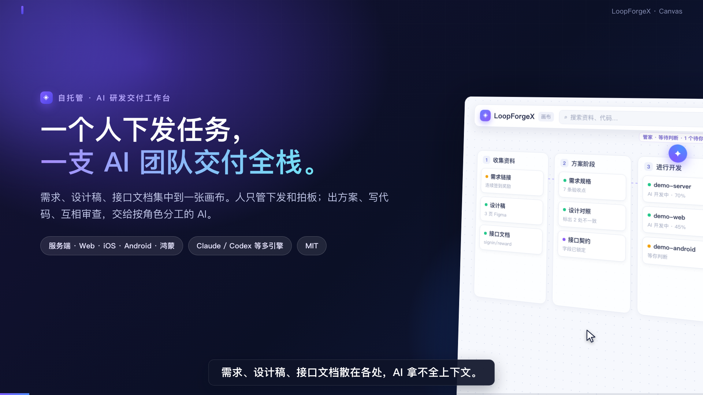
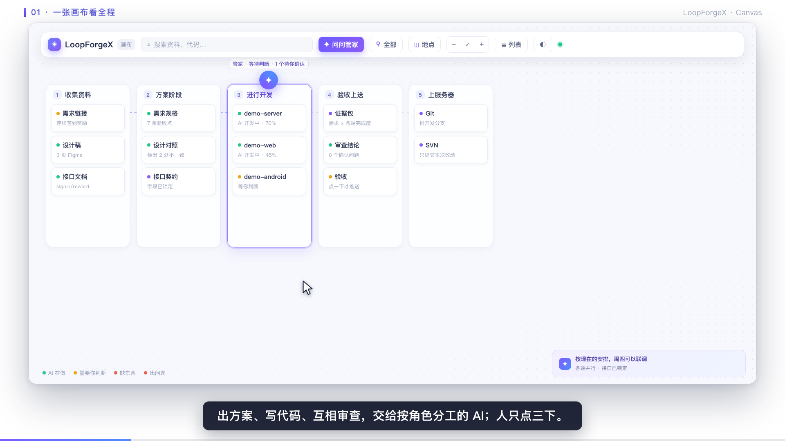
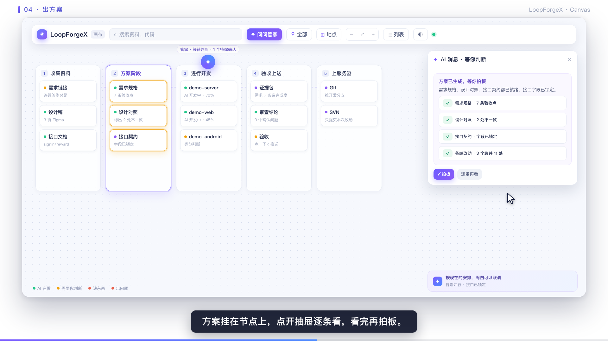
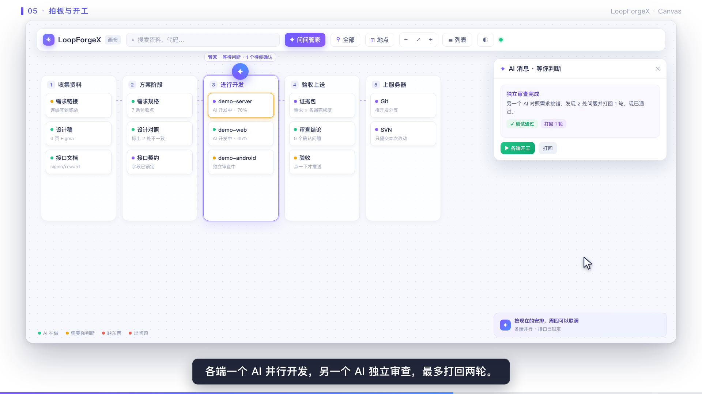
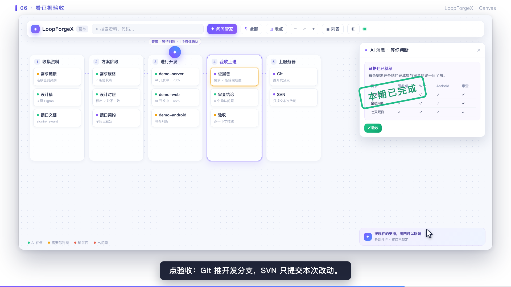

<p align="center">
  <picture>
    
  </picture>
</p>

<p align="center">
  <a href="assets/LoopForgeX-产品演示-中文.mp4"><b>▶ 看 96 秒产品演示（中文 · 含配音）</b></a>
  · <a href="assets/demo-zh.srt">字幕</a>
</p>

<p align="center">
  <a href="https://github.com/VcStrong/LoopForgeX/actions"></a>
  <a href="LICENSE"></a>
  
  <a href="https://github.com/VcStrong/LoopForgeX/stargazers"></a>
</p>

<p align="center">
  <b>简体中文</b> · <a href="README.md">English</a>
</p>

<p align="center">
  <a href="#两种用法">两种用法</a> · <a href="#为什么需要-loopforgex">为什么需要</a> · <a href="#快速开始">快速开始</a> · <a href="#流程如何运转">流程如何运转</a> · <a href="#功能">功能</a> · <a href="#常见问题">常见问题</a> · <a href="#文档">文档</a>
</p>

**LoopForgeX**（本地知识库 · AI 研发工作台）是一个自托管的软件交付工作台。把需求、设计稿、接口文档集中到一张项目画布上，用聊天把任务下发给 **管家**；它会拉起沙箱、按项目角色分工、跑检查、在人工关卡停下来等你拍板，最后提交代码。

当一种做法被验证有效，就把它固化成可复用的**流程**：下一个需求按同样的方式交付，审查和审批内建其中。coding agent 负责干活，LoopForgeX 负责围绕它们的角色、沙箱、关卡、证据和历史——全部跑在你自己的机器上。

<p align="center">
  
  <sub>画布：整站是一张可缩放的项目地图。点任意节点，从右侧抽屉看详情。</sub>
</p>

## 两种用法

同一份需求贯穿始终，可以单独用，也可以混着用。

| | 和管家聊天 | 跑一条流程 |
|---|---|---|
| **适合** | 探索、快速修复、和 AI 反复迭代 | 阶段固定、检查固定、要签字的可重复交付 |
| **怎么跑** | 管家开一个对话工作区（带仓库的沙箱），把项目角色当子 Agent 调用 | 引擎按顺序执行 Agent、脚本、人工关卡、子流程节点，各自在沙箱里 |
| **你在哪里把控** | 回复中途插话、暂停 / 接管正在跑的流程 | 在人工关卡审批、打回指定步骤、从任意节点重跑 |
| **交付物** | 改好的代码 + 会话记录 | 代码 + 每个节点的产物快照 + 审批记录 |

两条路共享同一份**需求追踪**：不管是对话还是流程做的改动，都能回溯到当初要的是什么，并计入交付和成本统计。

## 为什么需要 LoopForgeX

让一个 coding agent 去「修这个 Bug」，结果全看那一次运行：它可能跳过规划、忘了测试、自己审自己的代码，或者做到一半没人发现。

做 demo 没问题，但团队交付不是这么干的。

- **可重复。** 同一个流程、同样的阶段、同样的检查，对每个需求都一样。
- **角色分离。** 规划、实现、审查、测试各有自己的提示词、执行器、模型、规则和工具；审查不跟开发用同一个。
- **人在环上。** Agent 自己跑，你只在关键节点拍板、开工、验收——这三下 AI 不能替你点。
- **可观测、可续跑。** 节点状态、工具调用、日志、产物都在一处；中断后从断点继续。
- **你的技术栈、你的服务器。** 代码、资料、密钥都不离开你的 Mac 或服务器，MIT 开源。

## 快速开始

```sh
git clone https://github.com/VcStrong/LoopForgeX.git ~/loopforgex
cd ~/loopforgex && ./install.sh
# 部署到服务器：./install.sh --host 0.0.0.0 --autostart
```

装完自动打开浏览器，首页「三步上手」带你走一遍：**检测 AI 引擎 → 勾选本机代码仓库 → 放进第一个需求**。不想自己准备，点「先看一个示例」；不会用就点右下角「问管家」。

**前置条件**

| 想做什么 | 需要什么 |
|---|---|
| 跑一遍内置的「脚本 + 人工关卡」示例 | Git、Python 3、Docker（安装器会自动引导装） |
| 用管家聊天、生成文档或新项目 | 上面 + 一个已登录的 coding agent CLI |
| 改一个真实仓库并开 PR | 上面 + 仓库访问权（SSH 个人 key）、对应的模型凭据 |

<details>
<summary><b>更多安装细节</b>：执行器、模型凭据、沙箱、访问模型</summary>

- **执行器**：内置多种 coding agent CLI，可任选；每个角色的提示词、模型、规则独立配置。密钥只存在你自己的机器上。
- **沙箱**：运行在 Docker 沙箱里；需要 Docker socket 访问权限。这是为可信团队设计的自托管方案，不是面向公网多租户的隔离边界。
- **访问模型**：新安装默认监听所有网卡且开放注册。放到公网前请关闭注册、配置 HTTPS、限制网络可达范围。
- **Git 与 SVN**：都能接；开发前、推送前、切分支前自动更新，冲突就停下来提示。

</details>

## 流程如何运转

**流程（flow）就是一次交付要走的路。** Agent、脚本和人参与同一次运行：

| 节点 | 做什么 |
|---|---|
| **Agent** | 一个项目角色（提示词 + 执行器 + 模型 + 规则 + 工具），负责规划、实现、审查或测试 |
| **Script** | 确定性的 shell 步骤：构建、测试、lint、生成报告——不需要 AI 的地方就不用 AI |
| **人工关卡** | 暂停运行，等人检查产物后批准，或打回指定步骤 |
| **子流程** | 把另一条流程当作子流程嵌进来 |

每个节点声明自己的产物和依赖，依赖一完成，引擎就启动下一步。

<p align="center">
  
  <sub>出方案：需求规格、设计对照、各端改动和接口契约挂在节点上，点开抽屉逐条看，看完再拍板。</sub>
</p>

<p align="center">
  
  <sub>拍板开工后：各端一个 AI 并行开发，另一个 AI 独立审查，发现问题自动打回，最多两轮。</sub>
</p>

做到一半发现别的端也得改？开发 AI 自己提变更 → 出增量方案 → 你拍板 → 受影响的端自动补做。流程可以反复，不用推倒重来。

<p align="center">
  
  <sub>证据包验收：每条需求在各端的完成度和审查结论一目了然；点验收后才推送或提交。</sub>
</p>

## 功能

| 方面 | 你能得到什么 |
|---|---|
| **画布工作台** | 整站是一张可缩放的项目地图，五列泳道贯穿收集→方案→开发→验收→上服务器；点节点从抽屉看详情 |
| **两种工作方式** | 和管家对话、跑流程，两条路共享需求追踪 |
| **角色** | 可复用的角色定义：提示词、执行器、模型、规则、Skills、MCP 工具、产物与门禁 |
| **需求 → 交付** | 需求端到端追踪，PR/MR 状态、合并检测；Git / SVN 都支持 |
| **运行与审批** | 实时节点状态、工具调用轨迹、每节点产物快照；人工关卡审批、打回、从任意节点重跑 |
| **Bug 与崩溃** | 多平台只读同步、自动归并；mapping 还原堆栈，修完复发自动提醒 |
| **设计稿对照** | 出方案时逐页核对设计稿与需求，不一致先标出来 |
| **工作统计** | 各期进度、解决的问题、AI 跑了几次，自动汇总 |
| **插件扩展** | 外部系统做成插件接进来，本体保持通用 |
| **团队可用** | 数据留在自己服务器；关键决定只能人点 |

## 安全

- 🔒 **数据留在自己手里**：装在你的 Mac 或服务器上，资料不经过第三方平台。
- 👁️ **Bug 平台只读**：只从平台拉数据，从不回写；修复状态只记在本地。
- 🗝️ **密码不落明文**：Mac 用钥匙串，服务器用加密文件；网页要登录，远程连接用令牌。
- ✋ **关键决定只能你做**：拍板、开工、验收只能由你本人在网页上点，AI 不能代点。

> 注意：默认安装面向**可信团队内部**。Docker 沙箱通过宿主 Docker socket 运行，等同于持有宿主 Docker 守护进程的权限；不要直接暴露到公网多租户环境。上线前请关闭注册、配置 HTTPS、限制网络可达范围。

## 常见问题

**我需要先有模型 API key 吗？**
跑内置的「脚本 + 人工关卡」示例不需要，装完就能试完整流程。要让 Agent 真正干活，需要配置一个 coding agent CLI 的凭据。

**我需要 GitHub 吗？**
跑示例、生成文档不需要。要改真实仓库并开 PR 就需要；也支持其他 Git 服务和 SVN。

**该用对话还是流程？**
探索、一次性修复用对话；同一个做法要做很多次、且每次都要检查和签字，就固化成流程。

**它和 Dify、n8n、Flowise 有什么区别？**
那些是通用的自动化 / AI 工作流工具。LoopForgeX 专为**带 coding agent 的软件交付**而生：实现与审查角色、带真实仓库的沙箱、代码托管交付、人工验收关卡、运行证据。

**和直接用 Claude Code、Codex 有什么区别？**
它不替代这些 CLI，而是编排它们。每一次 Agent 步骤、每一轮对话都在跑其中一个 CLI；LoopForgeX 增加的是外围治理：谁在哪个沙箱、按什么顺序、带哪些检查、谁签字。

**暴露到公网安全吗？**
默认配置不适合公网。请按上面的安全说明收窄访问。

## 文档

| 我想…… | 从这里开始 |
|---|---|
| 装起来并跑通第一个需求 | [使用说明](使用说明.md) |
| 了解界面模板与画布 | [使用说明 · 界面](使用说明.md) |
| 看英文版 | [README.md](README.md) |

## 社区

欢迎提 Issue 和 PR，一起定义 AI 时代的软件交付方式。

## 贡献

提 Issue、开 PR 都欢迎。发现安全问题请私下反馈，不要公开披露。

## 许可证

MIT。第三方组件各自保留其许可证。
